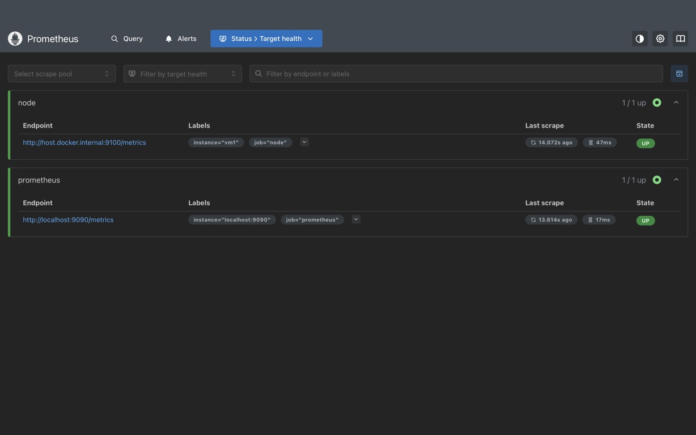
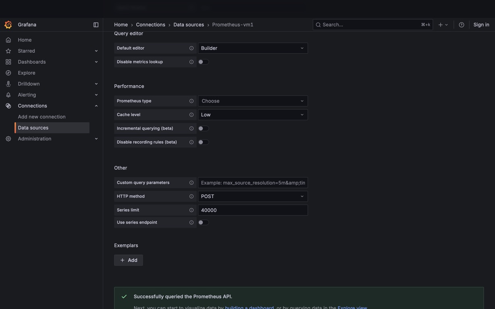
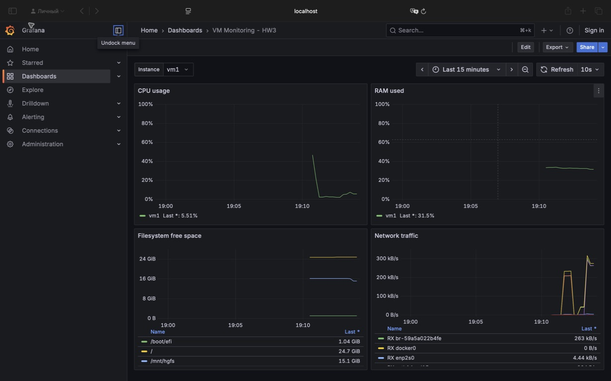

# Домашнее задание 3

Решение состоит из двух частей:

1. мониторинг Ubuntu VM через Node Exporter, Prometheus и Grafana;
2. три Docker-образа приложения `counter-backend`.

Полный отчёт с выполненными командами и их выводом находится в [HW3.ipynb](HW3.ipynb).

## Мониторинг

```bash
cd monitoring
docker compose up -d
docker compose ps
```

- Prometheus: <http://localhost:9090>
- Node Exporter: <http://localhost:9100/metrics>
- Grafana: <http://localhost:3000> (`admin` / `admin`)

В Prometheus настроена цель `node` с меткой `instance="vm1"`. В Grafana создан собственный дашборд с переменной `instance` и панелями CPU, RAM, свободного места и сетевого трафика. Его экспорт находится в [monitoring/grafana/dashboard.json](monitoring/grafana/dashboard.json).







## Docker-образы

```bash
cd counter-backend
docker build -f Dockerfile.single -t counter-backend:single .
docker build -f Dockerfile.multistage -t counter-backend:multistage .
docker build -f Dockerfile.nonroot -t counter-backend:nonroot .
```

Полученные на Ubuntu ARM64 размеры:

| Образ | Пользователь процесса | Размер |
| --- | --- | ---: |
| `counter-backend:single` | `root`, UID 0 | 391 MB |
| `counter-backend:multistage` | `root`, UID 0 | 260 MB |
| `counter-backend:nonroot` | `counter`, UID 1001 | 261 MB |

Каждый образ проверен отдельным контейнером: первый `GET /api/counter` вернул `200 {"count": 0}`, `POST` вернул `201 {"count": 1}`, следующий GET подтвердил сохранение значения.
